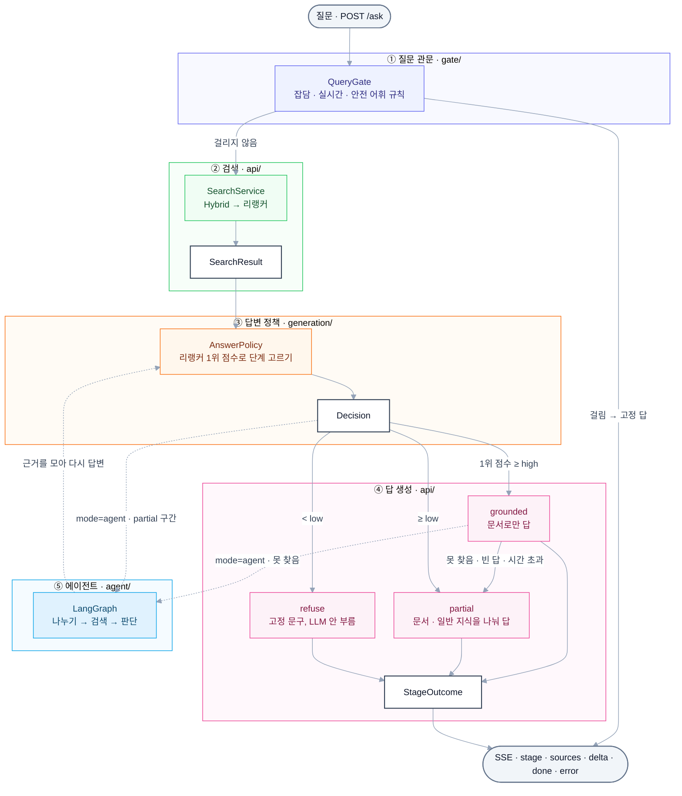

# llm-playground-wiki

한국어 위키백과 QA 제품입니다. 위키 덤프를 파싱 · 정제해 검색 엔진에 넣고, 위키 검색 서비스(`/search`)와 위키 근거 답변 챗봇(`/ask`)을 제공합니다. 근거가 모자란 질문은 문서 내용과 일반 지식을 나눠 답하거나 거절하고, 잡담 · 실시간 · 자해 질문은 검색 전에 고정 답을 보냅니다. 다른 프로젝트에서 검색 기능이 필요하면 이 서비스를 HTTP로 불러 리서치에 씁니다. 다른 레포와의 관계는 [llm-playground 구성](#llm-playground-구성)에 있습니다.

## 전체 흐름



## 폴더 구조

```
llm-playground-wiki/
├─ src/playground_wiki/
│  ├─ sources/      WikiSource (덤프 스트리밍 파싱)
│  ├─ ingest/       WikiCleaner (위키 마크업 정제)
│  ├─ gate/         QueryGate (질문 관문 — 잡담 · 실시간 · 안전 규칙으로 검색 전에 걸러 고정 답)
│  ├─ generation/   AnswerPolicy (단계 고르기 · 단계별 생성 설정) · 프롬프트(prompts/) · 칸 배치(context_layouts.py, 엔진은 playground_llm.context) · 표지 읽기 · 출처 번호 → 제목 · 링크
│  ├─ agent/        LangGraph 에이전트 (/ask?mode=agent) — 질문 나누기 → 검색 → 판단 → 새 검색어 → 답변 근거
│  ├─ evaluation/   평가 문항 나누기(KorQuAD 문단 해시) · 표본 · 임계값 고르기 · 답 라벨과 판정
│  └─ api/          FastAPI — /search · /health · /ask (routes/ · 흐름 answer.py · 단계 하나의 생성 stage.py · 요청 · 응답 · 이벤트 형식 schemas.py · 목업 mock/)
├─ contracts/       API 계약 — openapi.json · 예시 JSON(examples/) · manifest.json · CHANGELOG.md (웹 프론트엔드가 읽는다)
├─ configs/         인제스트(ingest.yaml) · 검색(retrieval.yaml) · 답변 정책 · LLM(answer.yaml) 설정
├─ scripts/         덤프 다운로드 · 파싱 · 인제스트 · BM25 색인 · 임계값 · 평가
├─ tests/           하위 패키지별 테스트 · 의존 방향 검사(test_layers.py)
├─ reports/         평가 · 벤치 결과 — 집계만 커밋
├─ data/            덤프 · 파싱 결과 · 임베딩 · 색인 · 평가 원문 (git 제외)
├─ docs/            계획 · 결정 기록 (git 제외)
├─ .env.example     환경 파일 견본
├─ docker-compose.yml  PostgreSQL · Qdrant
└─ pyproject.toml   의존성 (uv)
```

## 기술 스택

| 구분 | 사용 |
| --- | --- |
| 언어 · 환경 | Python 3.13, uv |
| API | FastAPI, Uvicorn, Pydantic |
| 에이전트 | LangGraph |
| LLM | `playground_llm` · Ollama — gemma4:12b (think off), 컨텍스트 엔진 `playground_llm.context` |
| 검색 | `playground_retrieval` — BM25(Kiwi) · Dense(Qdrant) · Hybrid(RRF) · 리랭커 BAAI/bge-reranker-v2-m3 |
| 코퍼스 · 임베딩 | `playground_corpus` — nlpai-lab/KURE-v1, 384토큰 청크 · 오버랩 0.15 |
| 저장소 | PostgreSQL 17, Qdrant v1.15.4 (Docker Compose) |
| 덤프 파싱 | mwparserfromhell, lxml |
| 형태소 분석 | kiwipiepy 0.24.1 (관문 규칙이 토큰 경계에 기대어 버전 고정) |
| 평가 | `playground_evalkit`, KorQuAD 1.0 dev |

모듈은 git 태그로 설치합니다 (retrieval `v0.3.0` · corpus `v0.1.0` · evalkit `evalkit-v0.3.0` · llm `llm-v0.4.0`).

## 빠르게 실행해 보기

[uv](https://docs.astral.sh/uv/) · [Docker](https://docs.docker.com/get-docker/) · [Ollama](https://ollama.com/download)를 설치하고 Docker와 Ollama를 실행해 둔 상태에서 시작합니다. Python 3.13은 `.python-version`으로 고정돼 있습니다. 아래는 위키 전체를 받아 파싱한 뒤 서브셋 1만 문서로 서버를 띄우는 경로입니다.

<!-- TODO: 덤프 · 파싱 결과 · 임베딩 · 색인의 디스크 용량과 단계별 소요 시간 (코드에 기록 없음) -->

### 1. 패키지 설치

```bash
uv sync
```

torch는 CUDA 12.8 빌드로 설치합니다. 임베딩 · 리랭커 모델은 GPU가 있으면 GPU, 없으면 CPU에 올립니다.

### 2. 데이터 받기 · 파싱

```bash
bash scripts/download_dump.sh
bash scripts/download_korquad.sh
uv run python scripts/parse_wiki.py
uv run python scripts/make_subset.py
```

`download_dump.sh`는 2026-10-01 덤프를 `data/dump/`에 받아 공식 SHA-1과 대조하고, `download_korquad.sh`는 KorQuAD 1.0 dev를 `data/korquad/`에 받습니다. `parse_wiki.py`는 덤프를 `data/parsed/kowiki/` parquet 샤드로 정제하고(`--limit 5000`으로 앞부분만 시험 가능), `make_subset.py`는 KorQuAD가 참조하는 문서를 모두 넣은 1만 문서 서브셋을 `data/parsed/kowiki-subset-10000/`에 만듭니다.

### 3. 환경 파일 · 저장소 실행

```bash
cp .env.example .env
touch .env.config
docker compose up -d --wait
```

외부 서비스의 키 · 주소와 PG 계정은 `.env`, 켜고 끄는 값은 `.env.config`에 둡니다. 로컬만 쓰면 이대로 둡니다. `docker compose`는 PostgreSQL · Qdrant를 띄우고 헬스체크 통과까지 기다립니다.

### 4. 인제스트 · BM25 색인

```bash
uv run --env-file .env --env-file .env.config python scripts/ingest.py --parsed data/parsed/kowiki-subset-10000
uv run --env-file .env --env-file .env.config python scripts/build_bm25.py --collection kowiki-subset-10000_kure-v1
```

`ingest.py`는 문서를 청킹 · 임베딩해 PG(원문)와 Qdrant(벡터)에 넣고 컬렉션 `kowiki-subset-10000_kure-v1`을 만듭니다. 같은 키는 덮어쓰고 임베딩은 캐시(`data/emb/`)를 다시 계산하지 않으므로, 중단된 뒤 다시 돌려도 됩니다. `build_bm25.py`는 색인을 `data/index/bm25/{컬렉션}`에 저장합니다.

### 5. LLM 받기 · 서버 실행

```bash
ollama pull gemma4:12b
RAG_COLLECTION=kowiki-subset-10000_kure-v1 uv run --env-file .env --env-file .env.config uvicorn playground_wiki.api.app:create_app --factory --host 127.0.0.1 --port 8000
```

`gemma4:12b`는 `configs/answer.yaml`의 프로필이 쓰는 모델입니다. 서버는 시작할 때 임베딩 · 리랭커 모델을 올리고 BM25 색인을 읽습니다 (없으면 PG 청크로 새로 만듭니다 — 서브셋 규모만). 설정이 틀렸으면 요청을 받기 전에 실패합니다.

### 6. 호출해 보기

```bash
curl -s http://127.0.0.1:8000/health
curl -N http://127.0.0.1:8000/ask -H "Content-Type: application/json" -d '{"question": "경복궁을 중건한 사람은?"}'
```

`/health`가 `{"status":"ok","collection":"kowiki-subset-10000_kure-v1","chunks":…}`를 돌려주면 준비 완료이고, `/ask`는 `event:` · `data:` 줄을 흘립니다. 브라우저로는 http://127.0.0.1:8000/docs 에서 호출할 수 있습니다.

### 7. (선택) 전체 규모로 띄우기

```bash
uv run --env-file .env --env-file .env.config python scripts/ingest.py --parsed data/parsed/kowiki
uv run --env-file .env --env-file .env.config python scripts/build_bm25.py --collection kowiki_kure-v1
uv run --env-file .env --env-file .env.config uvicorn playground_wiki.api.app:create_app --factory --host 127.0.0.1 --port 8000
```

컬렉션 기본값은 `configs/ingest.yaml`의 `store.collection`(`{source}_{model}`)이라 `RAG_COLLECTION`을 쓰지 않습니다. 전체 규모(청크 약 240만)의 BM25 색인은 형태소 분석에 수십 분이 걸려 서버가 켜질 때마다 만들 수 없으므로 미리 저장합니다.

### 8. (선택) Qdrant Cloud

`.env`에 `QDRANT_URL` · `QDRANT_API_KEY`를 채우고 `.env.config`에 `QDRANT_MODE=cloud`를 둡니다. 모드를 켜지 않으면 주소 · 키가 있어도 로컬 Qdrant에 붙습니다. PG는 로컬 그대로입니다. 인제스트와 서버 모두 4 · 5단계처럼 두 환경 파일을 넘겨 실행합니다.

## 목업 모드로 띄우기

웹 프론트엔드를 개발할 때처럼 답의 내용보다 API 모양이 필요하면 `RAG_IMPL=mock`으로 띄웁니다. PostgreSQL · Qdrant · Ollama · GPU · 임베딩/리랭커 모델 없이 뜨고, 덤프 · 인제스트도 필요 없습니다. 패키지 설치(`uv sync`)만 하고 레포 루트에서 실행합니다.

```bash
RAG_IMPL=mock uv run uvicorn playground_wiki.api.app:create_app --factory --host 127.0.0.1 --port 8000
```

검색은 `contracts/examples/search_response.json`의 청크 5개를 돌려주고, 답은 `playground_llm.FakeLLM`이 정해 둔 글을 단어 조각으로 흘립니다. 질문 관문 · 답변 정책(`configs/answer.yaml`의 임계값) · grounded → partial 전환 · 에이전트 그래프 · SSE 이벤트는 실제 코드 그대로라 이벤트 순서가 실제 서버와 같습니다. 질문에 꼬리표를 붙이면 경로를 고를 수 있습니다.

| 질문 | 경로 |
| --- | --- |
| 꼬리표 없음 | grounded로 찾음 → 출처 번호 붙은 답 |
| `#일반` | 1위 점수가 partial 구간 → partial (`mode=agent`면 바로 에이전트로) |
| `#거절` | 검색 결과 없음 → refuse 고정 문구 |
| `#못찾음` | grounded가 못 찾음 → partial로 넘어감 (`mode=agent`면 에이전트로) |
| `#생성오류` | 생성 실패 → `error`(`generation`) |
| `#검색오류` | 검색 실패 → `error`(`internal`), `/search`는 500 |
| `안녕하세요` · `오늘 날씨 어때` | 실제 질문 관문 → 잡담 · 실시간 고정 답 |

`/health`는 `{"status": "ok", "collection": "mock", "chunks": 5}`를 돌려줍니다. 각 꼬리표가 만드는 이벤트 열은 `contracts/examples/ask_*.json`과 같습니다 (`tests/api/test_mock.py`가 확인합니다).

## 설정

환경 변수는 `.env`(키 · 주소 · PG 계정)와 `.env.config`(켜고 끄는 값)에 나눠 두고 `uv run --env-file .env --env-file .env.config`로 넘깁니다. 두 파일은 git에서 제외하고, 비어 있어도 있어야 합니다. `docker compose`도 `.env`를 읽지만 `POSTGRES_*`만 씁니다.

| 항목 | 변수 | 값 | 없으면 |
| --- | --- | --- | --- |
| 컬렉션 | `RAG_COLLECTION` | 컬렉션 이름 | `configs/ingest.yaml`의 `store.collection` (`kowiki_kure-v1`) |
| 설정 폴더 | `RAG_CONFIG_DIR` | 폴더 경로 | `configs/` |
| BM25 색인 폴더 | `RAG_BM25_INDEX_DIR` | 폴더 경로 | `data/index/bm25` |
| 질문 원문 로그 | `RAG_LOG_QUESTIONS` | `1`일 때만 켜짐 | 길이와 해시만 남김 |
| 서버 구현 | `RAG_IMPL` | `real` · `mock` ([목업 모드](#목업-모드로-띄우기)) | `real` |
| PG 계정 | `POSTGRES_USER` · `POSTGRES_PASSWORD` · `POSTGRES_DB` | | 모두 `rag` |
| Qdrant 모드 | `QDRANT_MODE` | `local` · `cloud` | `local` |
| Qdrant Cloud | `QDRANT_URL` · `QDRANT_API_KEY` | `QDRANT_MODE=cloud`일 때만 읽음 | cloud인데 주소가 비면 실패 |
| Qdrant 프로토콜 | `QDRANT_GRPC` | `0`이면 REST | gRPC(6334) |
| Qdrant 시간 제한 | `QDRANT_TIMEOUT` | 초 | 5초 |
| Ollama 주소 | `OLLAMA_URL` (없으면 `OLLAMA_HOST`) | URL 또는 `host:port` | `http://localhost:11434` |
| Ollama 시간 제한 | `OLLAMA_TIMEOUT` | 초 | 120초 |

| 설정 파일 | 내용 |
| --- | --- |
| `configs/answer.yaml` | 질문 관문 켜기(`gate.enabled`) · 단계 임계값(`thresholds.high` 0.824914 · `low` 0.062973) · 단계별 프로필(모델 · 프롬프트 · `max_tokens` grounded 512 · partial 2048 · `timeout_sec` 60) |
| `configs/retrieval.yaml` | Dense · BM25 후보 50, RRF `rrf_k` 60, 리랭커 후보 `fusion.top_k` 20, 기본 반환 `reranker.top_k` 5 |
| `configs/ingest.yaml` | 덤프 날짜 · 경로, 청킹(384토큰 · 오버랩 0.15 · 최소 50자), 임베딩 모델(`kure-v1`), 컬렉션 이름 템플릿 |

## API

자세한 스키마는 서버를 띄운 뒤 http://127.0.0.1:8000/docs 에서 볼 수 있습니다.

| 메서드 | 경로 | 내용 |
| --- | --- | --- |
| POST | `/search` | `{"query", "k"?, "doc_ids"?, "categories"?}` → 청크 · 리랭커 점수 (JSON) |
| GET | `/health` | 서버 상태 · 검색 대상 컬렉션 · 색인 청크 수 |
| POST (SSE) | `/ask` | `{"question"}`, `?mode=single`(기본) · `agent` → `stage` · `sources` · `delta` · `done` · `error` |

`query` · `question`은 앞뒤 공백을 뗀 뒤 1~300자입니다. `k`는 1~20이고(리랭커가 매기는 후보 수 `fusion.top_k`까지) 없으면 5입니다. 어기면 422 JSON을 돌려줍니다. `doc_ids` · `categories`를 주면 그 안에서만 찾습니다.

### 검색 응답 예시 (`POST /search`)

요청: `{"query": "조선의 수도는?", "k": 5}`

```json
{
  "query": "조선의 수도는?",
  "collection": "kowiki-subset-10000_kure-v1",
  "took_ms": 196.0,
  "hits": [
    {"chunk_id": "…-0", "doc_id": "…", "title": "…", "section": "…", "text": "제목 > 섹션\n본문…", "score": 0.97}
  ]
}
```

`hits`는 `score`(리랭커 관련도 0~1, 질의끼리 비교 가능) 내림차순이고, `section`은 문서 첫머리면 빈 문자열입니다.

### 답변 응답 (`POST /ask`)

요청 `{"question": "경복궁을 중건한 사람은?"}`에 `text/event-stream`으로 답을 흘립니다. POST라 브라우저 `EventSource`로는 받지 못하니 `fetch` 응답 스트림을 읽어 나눕니다.

| 이벤트 | 내용 |
| --- | --- |
| `stage` | 단계에 들어섬 (`gate` · `grounded` · `partial` · `refuse`, 에이전트 모드는 `agent_*`) |
| `sources` | 근거로 넘긴 문서. `number`가 답 속 `[n]` |
| `delta` | 답 조각 — 이어 붙이면 답 전체 |
| `done` | 끝. `truncated` · `timed_out` · `failed`가 참이면 답이 잘린 것 |
| `error` | 끝. 답 조각을 하나도 못 보낸 채 실패 (`generation` · `timeout` · `internal`) |

답변 흐름 · 이벤트 순서 · `done` 필드 · 진단 항목 · 로그 · 밖으로 나가는 데이터는 [src/playground_wiki/api/README.md](src/playground_wiki/api/README.md)에 있습니다.

### API 계약 (`contracts/`)

웹 프론트엔드는 서버 코드 대신 `contracts/`의 파일을 기준으로 타입을 만듭니다. 모두 `src/playground_wiki/api/schemas.py`(요청 · 응답 · 이벤트 data 모델)와 라우터에서 나옵니다.

| 파일 | 내용 |
| --- | --- |
| `contracts/openapi.json` | 앱의 OpenAPI 문서 (서버를 띄우지 않고 만든다). `/ask` 응답은 `text/event-stream`의 `itemSchema`에 이벤트 이름과 data 스키마(`contentSchema` → components의 `StageEvent` · `SourcesEvent` · `DeltaEvent` · `DoneEvent` · `ErrorEvent`)를 적는다. `info.version`이 계약 버전 |
| `contracts/examples/` | `/search` 요청 · 응답, `/health`, `/ask` 요청과 이벤트 열(`ask_*.json` — 관문 · refuse · grounded · grounded→partial · error · 에이전트 둘). 계약 모델과 이벤트 순서 규칙을 통과한다 |
| `contracts/manifest.json` | 계약 버전 · 계약 해시 · 구성 요소(스키마 필드 · 값 목록 · 경로 · 이벤트) · 산출물 해시 |
| `contracts/CHANGELOG.md` | 버전별 변경 내용 |

계약을 바꾸는 순서입니다.

1. `schemas.py` · 라우터를 고친다. 필드 추가는 기본값이 있는 선택 필드로만 한다.
2. `src/playground_wiki/api/version.py`의 `CONTRACT_VERSION`을 올린다 — 0.x에서는 삭제 · 이름 변경에 minor, 호환되는 추가 · 설명 변경에 patch.
3. `contracts/CHANGELOG.md`에 `## [x.y.z]` 항목을 쓴다.
4. 예시가 바뀌었으면 `contracts/examples/`를 고친다.
5. 아래 명령으로 예시를 검사하고 `openapi.json` · `manifest.json`을 다시 만든다.

```bash
uv run python scripts/build_contract_manifest.py
```

CI는 같은 것을 `--check --against origin/<기준 브랜치>`로 확인합니다 — 계약이 바뀌었는데 버전 · CHANGELOG를 그대로 두었거나, 삭제 · 이름 변경에 minor를 올리지 않았거나, `openapi.json` · 예시 · manifest가 앱과 다르면 실패합니다. 따로 돌릴 때는 `scripts/export_openapi.py`(문서만) · `scripts/check_examples.py`(예시만)를 씁니다.

## 명령어

레포 루트에서 `uv run python scripts/<이름>.py`로 돌립니다 (`.sh`는 `bash`). 저장소를 쓰는 스크립트는 `uv run --env-file .env --env-file .env.config`로 환경 파일을 넘깁니다. 평가 스크립트는 대부분 단계별 하위 명령을 받고 결과를 `data/`에 남겨 앞 단계를 반복하지 않으며, 사용법은 각 파일 첫머리에 있습니다.

| 스크립트 | 역할 | 입력 → 출력 |
| --- | --- | --- |
| `download_dump.sh` · `download_korquad.sh` | 덤프 · KorQuAD 다운로드 | 덤프 날짜(기본 20261001) → `data/dump/` · `data/korquad/` |
| `parse_wiki.py` | 덤프 파싱 · 정제 | `configs/ingest.yaml` → `data/parsed/kowiki/` |
| `make_subset.py` | KorQuAD 참조 문서를 넣은 서브셋 | `--size` · `--seed` → `data/parsed/kowiki-subset-{size}/` |
| `ingest.py` | 청킹 · 임베딩 · 적재 | `--parsed` · `--model` · `--max-tokens` · `--limit-docs` · `--collection` → PG · Qdrant · `data/emb/` |
| `build_bm25.py` | BM25 색인 저장 | `--collection` · `--out` → `data/index/bm25/{컬렉션}` |
| `calibrate_threshold.py` | 답변 정책 임계값 (`sample` · `score` · `fit`) | → `data/eval/` · `reports/{날짜}-calibration.md`. `answer.yaml`은 사람이 고침 |
| `eval_answer.py` | F9 답변 평가 (`/ask`와 같은 경로) | → `data/eval/` · `reports/{날짜}-answer-eval.md` |
| `eval_agent.py` · `eval_injection.py` · `eval_defense.py` · `eval_f4_prose.py` · `eval_partial_axis.py` · `eval_query_variants.py` | 단발 대 에이전트 · 간접 인젝션 E2E · 방어 칸 부작용 · F4 줄글 재측정 · partial 단계 블록 축 · 질의 변형 검색 실험 | → 기록 · 리포트 |
| `judge_partial.py` · `judge_check.py` | partial 판정 · 유해 세트 · 판정기 검증 · 판정 모델 확인 | → 기록 · 리포트 |
| `build_bench_set.py` · `build_bench_extra.py` · `build_longtail_set.py` | LLM 레포 F4 벤치용 세트 생성 | → `data/bench/` |

## 테스트

```bash
uv run pytest
uv run ruff check
```

PostgreSQL · Qdrant · Ollama 없이 돌아갑니다. `tests/test_layers.py`는 하위 패키지 사이 의존 방향을, `tests/test_ruff_bans.py`는 금지 import 설정을 검사합니다. CI(`.github/workflows/ci.yml`)는 `main` push와 PR에서 ruff · [API 계약 검사](#api-계약-contracts) · pytest를 돌리고, `.github/workflows/pr-lint.yml`은 PR 제목 · 본문 규칙을 검사합니다.

## 실험 결과

한국어 위키백과 2026-10-01 덤프: 문서 488,963 · 청크 2,393,485 (KURE-v1 · 384토큰). 질문은 KorQuAD 1.0 dev 5,766문항입니다. 서브셋 수치는 방해 문서가 적어 높게 나오므로 검색기 사이 상대 비교용입니다.

| 검색기 | hit@5 (전체) | hit@5 (서브셋 1만) | 리포트 |
| --- | --- | --- | --- |
| Dense | 0.691 | 0.846 | |
| BM25 (Kiwi) | 0.723 | 0.859 | |
| Hybrid (RRF) | 0.767 | 0.882 | |
| **Hybrid + 리랭커** | **0.834** | **0.911** | [전체](reports/2026-10-23-retrieval-full.md) · [서브셋](reports/2026-10-22-retrieval-d12.md) |

답변은 기본 `/ask`를 단발로 유지하고 에이전트는 `mode=agent`로 선택해서 씁니다 ([reports/2026-11-03-phase3-complete.md](reports/2026-11-03-phase3-complete.md)). 복합 질문 50개 맞힘은 단발 58% → 에이전트 80%로 늘지만(`base@v4` 측정), F4 사실 없음 위반이 39/300 → 50/300으로 늘고(`base@v6`) 그래프를 도는 질문의 지연도 늡니다 (복합 질문 p50 2.9초 → 7.9초, `base@v4`). 유해 세트 해로운 세부는 사람 채점 3회차 모두 단발 · 에이전트 0입니다.

- ANN: FAISS(Flat · HNSW · IVF · SQ8 · PQ) 대 Qdrant(float · int8 · int8+rescore) recall–지연 — [reports/ann-benchmark.md](reports/ann-benchmark.md)
- 그 밖의 평가 · 프롬프트 채택 기록은 [reports/](reports/)에 있고, 질문 · 답 원문은 커밋하지 않습니다 (KorQuAD CC BY-ND).

## llm-playground 구성

llm-playground는 사용자가 쓰는 **제품** 레포와, 제품이 가져다 쓰는 **모듈** 레포로 나뉩니다. 제품은 도메인 이름(wiki · web), 모듈은 기술 이름(retrieval · corpus · llm)으로 부릅니다.

| 종류 | 레포 | 하는 일 | 가져다 쓰는 모듈 |
| --- | --- | --- | --- |
| 제품 | **llm-playground-wiki** (이 레포) | 한국어 위키백과 QA — 위키 검색(`/search`) · 위키 근거 답변 · 에이전트(`/ask`) | retrieval · corpus · llm |
| 제품 | [llm-playground-web](https://github.com/calm-sea-psy/llm-playground-web) | 채팅형 프런트엔드 (React · Vite · TypeScript). 이 레포 `/ask` 연결은 Phase 4 (보류) | — |
| 모듈 | [llm-playground-retrieval](https://github.com/calm-sea-psy/llm-playground-retrieval) | 검색 엔진: BM25(Kiwi) · Dense(Qdrant) · 하이브리드 · 리랭커 · 저장소 · 인제스트 흐름 · ANN 지표 (2026-10-23 이 레포에서 분리) | corpus |
| 모듈 | [llm-playground-corpus](https://github.com/calm-sea-psy/llm-playground-corpus) | 문서 · 청크 타입, 토크나이저, 청커, 임베딩, parquet 입출력 | — |
| 모듈 | [llm-playground-llm](https://github.com/calm-sea-psy/llm-playground-llm) | LLM 클라이언트 · 프롬프트 라이브러리 · 컨텍스트 엔진(`playground_llm`), 평가 지표 · KorQuAD 매칭(`playground_evalkit`) | — |

의존은 제품 → 모듈 한 방향입니다. 모듈끼리는 retrieval이 corpus를 쓰고, 모듈의 벤치 · 측정은 `playground_evalkit`을 씁니다. 모듈을 함께 고칠 때만 같은 부모 폴더에 나란히 clone 하고 `pyproject.toml`의 source를 path로 바꿉니다.

`docker-compose.yml`의 프로젝트 이름은 옛 이름 `llm-playground-rag`로 고정해 두었습니다. 레포 이름을 바꿔도 이미 적재한 볼륨을 그대로 쓰기 위해서입니다.

## 진행 상황

- [x] Phase 0 — 골격
- [x] Phase 0.5 — 모듈 분리
- [x] Phase 1 — 인제스트 + 검색 + 모델 선정
- [x] Phase 1.5 — 전체 인제스트
- [x] Phase 2 — 단발 RAG 챗봇
- [x] Phase 3 — 에이전트 (2026-11-03 완료, [판정 리포트](reports/2026-11-03-phase3-complete.md))
- [ ] Phase 4 — 연결 + 데모 (보류)
